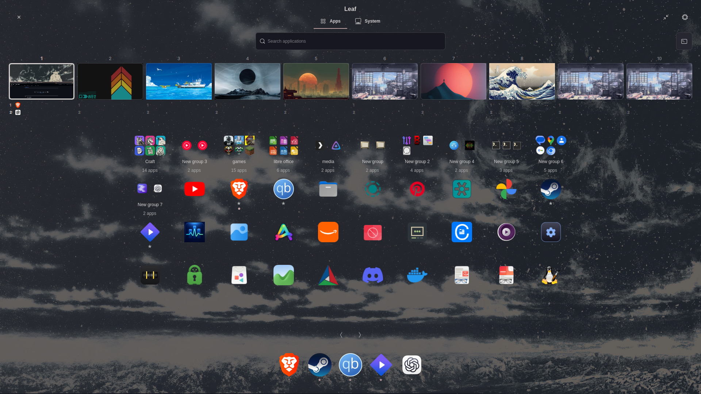
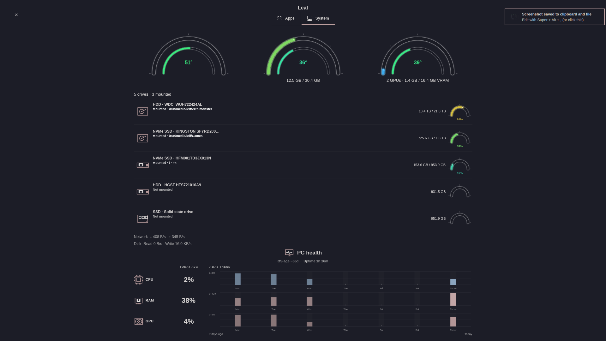
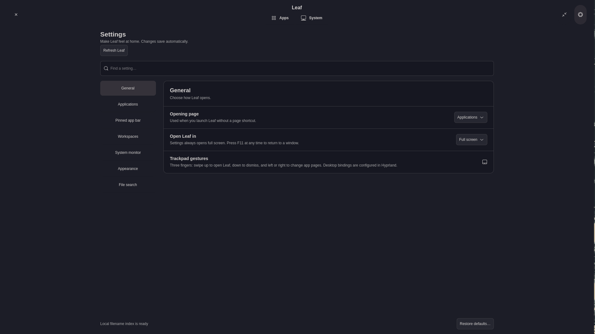

# Leaf

Leaf is one Omarchy plugin for applications, workspaces, and system monitoring. It provides a bar button and workspace overlay through Omarchy Shell, plus a GTK4 window with Apps, System, Tools, and Settings. Settings opens fullscreen; F11 or the header control switches to a resizable window for tiling. The Apps page includes favorites, local file search, app groups, a pinned/running app bar, and monitor-aware workspaces. The System page reads local CPU, memory, GPU, thermal, storage, and network data where available.

## Screenshots







## Install

Requirements: Omarchy Shell, Hyprland, Python 3, GTK4/PyGObject, and cairo's Python bindings. The launcher reports missing dependencies. To install or update from this source directory:

```sh
./install-user.sh
# Existing Leaf installation: ./install-user.sh --update
```

This installs **one** plugin (`io.github.bravehart911.leaf-control`), puts the Leaf button in the Omarchy bar, and creates a `leaf-control` command and desktop entry. It migrates `local.leaf-control` and the older `local.leaf-workspaces` plugin while retaining Leaf's bar position, favorites, and settings. On a fresh Omarchy profile it starts from Omarchy's full default shell configuration. Installation backs up replaced plugin files and shell configuration in `$XDG_STATE_HOME/leaf-backups/`. To remove a source installation, run `./uninstall-user.sh`; local preferences remain in place. If an update remains cached, run `omarchy restart shell`.

### Install from an Omarchy plugin repository

Install from the public Git repository with Omarchy's standard plugin command:

```sh
omarchy plugin add https://github.com/BraveHart911/leaf-omarchy-plugin.git --enable
~/.config/omarchy/plugins/io.github.bravehart911.leaf-control/install-user.sh --integration-only
```

The first command provides the bar button and workspace menu. The second adds the optional `leaf-control` command and desktop entry. Omarchy does not run plugin install hooks. Updates use `omarchy plugin update io.github.bravehart911.leaf-control`; the command and desktop entry continue to point at that plugin directory. Remove the optional integration before removing a Git-managed plugin:

```sh
~/.config/omarchy/plugins/io.github.bravehart911.leaf-control/uninstall-user.sh --integration-only
omarchy plugin remove io.github.bravehart911.leaf-control
```

The root of this directory is the complete Omarchy plugin package, including `manifest.json`, `BarWidget.qml`, and `Menu.qml`. The manifest exposes both the bar widget and menu under the same plugin ID. The GTK launcher resolves its resources relative to the installed plugin, without a developer-specific path. The setup script backs up any unrelated launcher or desktop entry it replaces and restores it on removal. It leaves modified integration files in place for manual review.

## Use

Left-click the Leaf bar button to open the app; right-click it for Settings. `leaf-control --settings` opens Settings directly, and `leaf-control --window` opens a resizable window. F11 toggles fullscreen. The Settings page has searchable categories, an editor for pinned apps, and controls for grid, workspace, system, and dock behavior.

The **Refresh Leaf** button at the top of Settings restarts the installed app and reloads its Python code, styling, and preferences. If you edit a separate source checkout, run `./install-user.sh --update` before refreshing.

Group tiles can be placed between applications and other groups. Drop a group on a page arrow to move it to that page, or use its context menu's previous/next page actions. Placement is saved independently of group membership. Manual placement turns off usage sorting.

## Trackpad gestures

Leaf includes optional Hyprland bindings for three-finger swipes: **up** opens Applications fullscreen, **down** dismisses Leaf, and **left/right** changes application pages. Horizontal and down actions only affect Leaf when its window is focused. These reserve the four three-finger swipe directions; check for existing bindings before enabling them. No extra trackpad daemon is needed.

After installation, add this once to your Hyprland `input.lua`, then reload Hyprland:

```lua
local config = os.getenv("XDG_CONFIG_HOME") or (os.getenv("HOME") .. "/.config")
local gestures = config .. "/omarchy/plugins/io.github.bravehart911.leaf-control/leaf-gestures.lua"
local file = io.open(gestures, "r")
if file then file:close(); dofile(gestures) end
```

The guard makes the configuration safe if Leaf is later uninstalled. The bridge uses the installed app; it supports Magic Trackpad devices recognized as touchpads by Hyprland/libinput.

Search covers installed applications and locally indexed filenames in configured XDG folders. Indexing reads names only and skips hidden directories and common caches. Drag app tiles to group or reorder them, and drag group tiles to place them among apps and other groups. Groups also support Ctrl+Up/Down and Move earlier/later in the context menu. Drag a running app icon or window preview between workspace cards to move its windows. Workspace cards follow the monitor on which Leaf opened and use that monitor's configured workspace IDs. XWayland apps such as Codex appear in workspace cards and can be moved by their preview or icon; if screencopy is unavailable, Leaf shows the application icon in the preview.

Leaf stores preferences, favorites, order, and groups under `$XDG_CONFIG_HOME/leaf-control/`; bounded system history is stored under `$XDG_STATE_HOME/leaf-control/`. It follows Omarchy's generated theme palette. Missing hardware metrics are shown as unavailable.

See [ARCHITECTURE.md](ARCHITECTURE.md) and [TESTING.md](TESTING.md) for implementation and verification notes.
